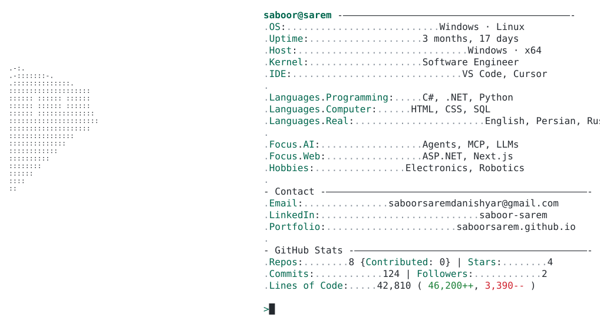
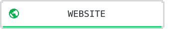
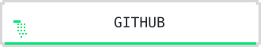
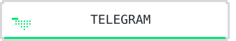
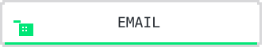
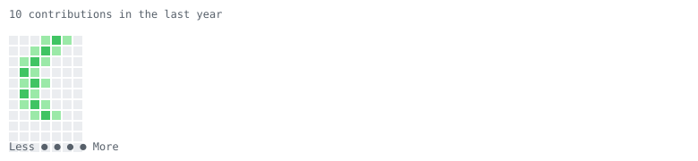

<a href="https://saboorsarem.github.io/">
  <picture>
    <source media="(prefers-color-scheme: dark)" srcset="https://raw.githubusercontent.com/saboorsarem/saboorsarem/main/dark_mode.svg">
    
  </picture>
</a>

<table align="center" width="100%" style="max-width:980px; border-spacing:0; border-collapse:collapse; background:#040b11; border:1px solid #1d2b2b; box-shadow:0 0 0 1px rgba(100,255,170,0.08);">
  <tr>
    <td style="padding:18px 18px 12px 18px;">
      <table width="100%" style="border-spacing:0; border-collapse:collapse; background:#040b11;">
        <tr>
          <td width="52%" valign="middle" align="center" style="padding:8px 12px 8px 8px;">
            

              
            

          </td>
          <td valign="middle" style="padding:8px 8px 8px 0; font-family:monospace; color:#8ef9b8; font-size:14px; letter-spacing:0.4px; line-height:1.7; white-space:nowrap;">
            

              
sabo

              
OS: Linux

              
Up: 29 years, 7 months, 25 days

              
Host: Kabul, Afghanistan

              
Kernel: Product &amp; Software Engineer

              
ID: VSCode, Cursor, Orca

              
Languages: TypeScript, Go, Python, C++

              
Languages.Computer: HTML, CSS, SQL, YAML, GraphQL

              
Languages.Real: Pashto, Persian, English

              
Focus.AI: Agents, MCP, LLM Automation

              
Focus.Web: Next.js, React, Node.js

              
Hobbies: AI, Robotics, Coding, Learning

              
Contact

              
Email: saboorsaremdanishyar@gmail.com

              
LinkedIn: linkedin.com/in/saboorsarem

              
Portfolio: saboorsarem.github.io

              
GitHub Stats

              
Repos: 69  |  Stars: 87  |  Commits: 1,307

              
Followers: 16  |  Following: 92

            

          </td>
        </tr>
      </table>
    </td>
  </tr>
</table>

  <a href="https://saboorsarem.github.io/">
    <picture>
      <source media="(prefers-color-scheme: dark)" srcset="https://raw.githubusercontent.com/saboorsarem/saboorsarem/main/link_website_dark.svg">
      
    </picture>
  </a>
  &nbsp;
  <a href="https://github.com/saboorsarem">
    <picture>
      <source media="(prefers-color-scheme: dark)" srcset="https://raw.githubusercontent.com/saboorsarem/saboorsarem/main/link_github_dark.svg">
      
    </picture>
  </a>
  &nbsp;
  <a href="https://t.me/saboorsarem">
    <picture>
      <source media="(prefers-color-scheme: dark)" srcset="https://raw.githubusercontent.com/saboorsarem/saboorsarem/main/link_telegram_dark.svg">
      
    </picture>
  </a>
  &nbsp;
  <a href="mailto:saboorsaremdanishyar@gmail.com">
    <picture>
      <source media="(prefers-color-scheme: dark)" srcset="https://raw.githubusercontent.com/saboorsarem/saboorsarem/main/link_email_dark.svg">
      
    </picture>
  </a>

<picture>
  <source media="(prefers-color-scheme: dark)" srcset="https://raw.githubusercontent.com/saboorsarem/saboorsarem/main/pacman_dark.svg">
  
</picture>
